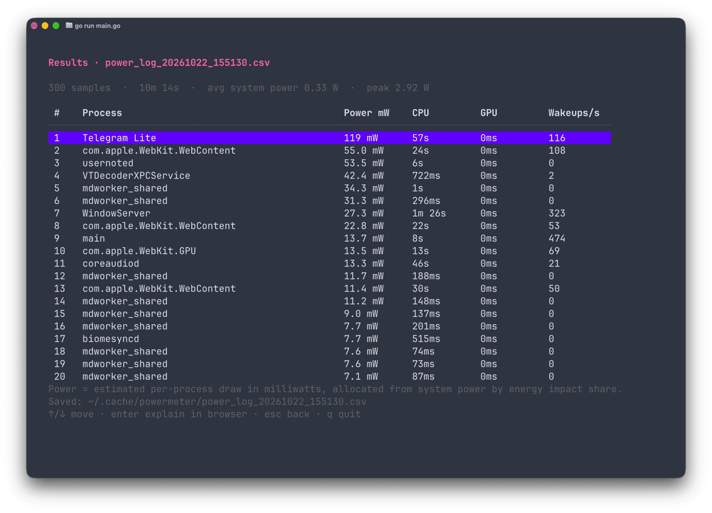

# Powermeter

Powermeter is a terminal app for macOS that shows how much power each process uses.

It runs the built-in `powermetrics` utility for a period of time that you choose. Then it shows the top 20 processes by power consumption, with an estimate in milliwatts (mW), CPU time, GPU time and wakeups per second.



## Requirements

- macOS 13+ (Go 1.27 requires macOS Ventura or newer)
- Administrator privileges

## Installation

### Homebrew

```sh
brew install cheatsnake/tap/powermeter
```

### Build from source

Build the binary from the source code:

```sh
git clone https://github.com/cheatsnake/powermeter.git
cd powermeter
go build -o powermeter ./cmd/cli
```

Then run it:

```sh
./powermeter
```

You can also install it into your Go bin directory:

```sh
go install ./cmd/cli
```

## Licence

MIT. See [LICENSE](LICENSE) file.
